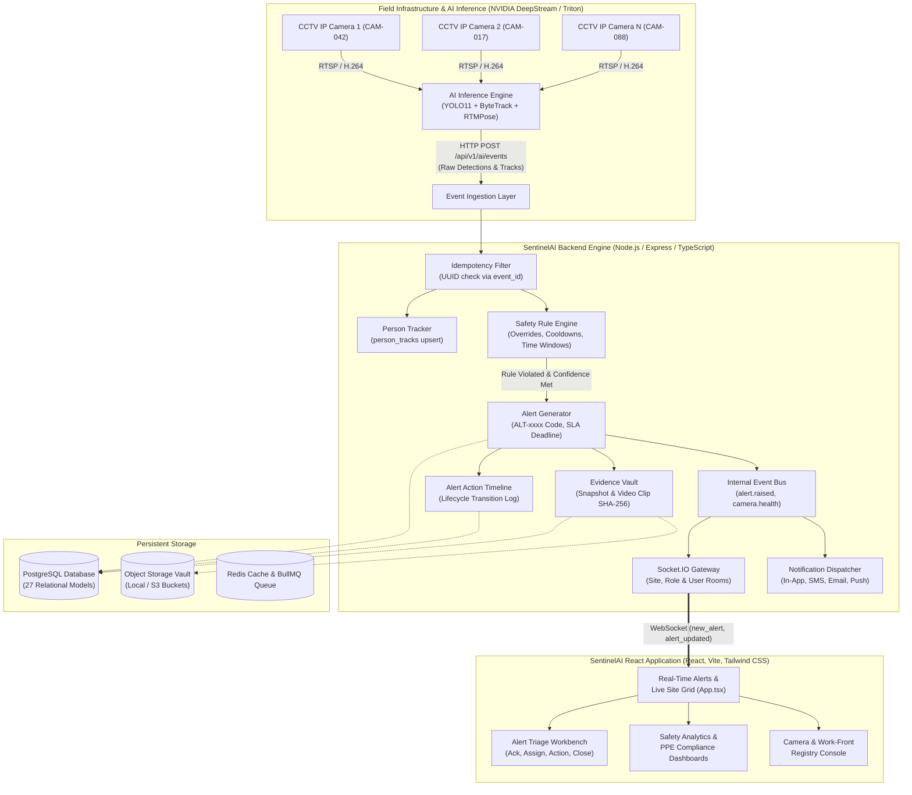
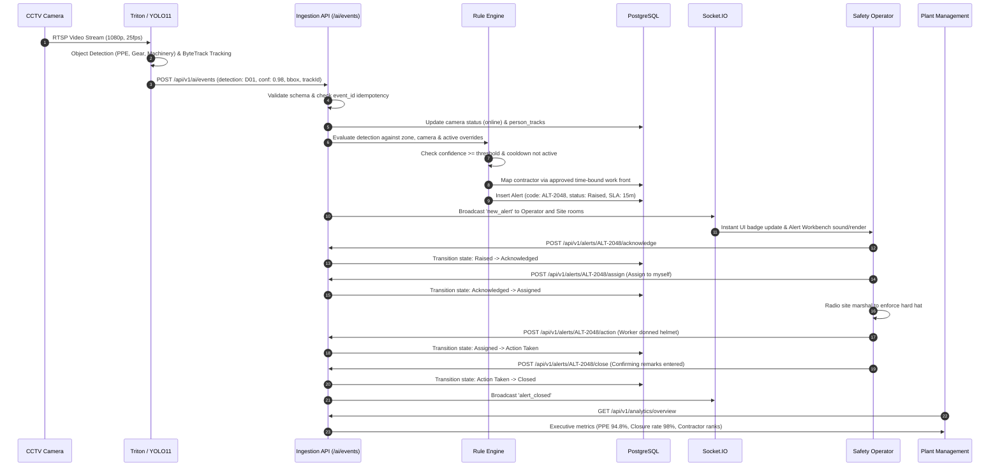
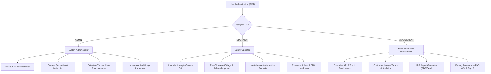
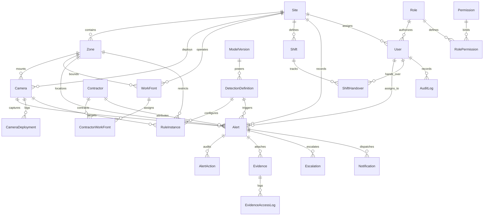

# 🛡️ SentinelAI — AI-Powered Visual Safety Surveillance Platform
### Enterprise-Grade Safety Intelligence for Industrial Plants, Factories & Construction Sites

---

## 📑 Table of Contents
1. [Executive Overview](#-1-executive-overview)
2. [End-to-End System Architecture](#-2-end-to-end-system-architecture)
3. [Complete Platform Working & Data Lifecycle](#-3-complete-platform-working--data-lifecycle)
4. [Key Features & Capabilities](#-4-key-features--capabilities)
5. [The 54 Safety Detection Catalog (D01–D54)](#-5-the-54-safety-detection-catalog-d01d54)
6. [Role-Based Access Control (RBAC) Matrix](#-6-role-based-access-control-rbac-matrix)
7. [Database Architecture (27 Relational Entities)](#-7-database-architecture-27-relational-entities)
8. [Frontend-to-Backend Integration Matrix](#-8-frontend-to-backend-integration-matrix)
9. [API Specifications & Swagger Documentation](#-9-api-specifications--swagger-documentation)
10. [Setup, Seeding & Execution Guide](#-10-setup-seeding--execution-guide)
11. [Testing & Quality Assurance](#-11-testing--quality-assurance)

---

## 🌟 1. Executive Overview

**SentinelAI** is an enterprise-grade, end-to-end AI-powered visual safety surveillance platform designed to automate occupational health and safety compliance across hazardous industrial environments (refineries, power plants, manufacturing facilities, and major infrastructure construction sites).

The platform replaces manual safety audits with continuous, 24/7 computer vision surveillance that detects violations in real-time, alerts on-site safety officers, enforces strict escalation and resolution workflows, and compiles audited safety intelligence for executive leadership.

### Technology Stack
- **Frontend**: React 19, TypeScript, Vite, Tailwind CSS 4, Radix UI / shadcn/ui, Lucide Icons
- **Backend API**: Node.js, Express.js 5, TypeScript
- **Database**: PostgreSQL 16 with Prisma ORM (27 Relational Models, UUID PKs, Soft Deletion, Audit Logs)
- **Real-Time Communication**: Socket.IO with Room-Based Access Control
- **Inference Integration**: REST Event Bus compatible with NVIDIA DeepStream, Triton, YOLO11, and ByteTrack
- **Validation & Security**: Zod runtime schema validation, JWT auth with refresh rotation, bcrypt (10 rounds), Helmet security headers, Express Rate Limiter
- **Storage**: Storage Adapter abstraction supporting Local Disk and S3-compatible Object Stores
- **Testing**: Vitest unit test suite covering authentication, alerts lifecycle, rule evaluation, evidence, and analytics

---

## 🏗️ 2. End-to-End System Architecture



---

## 🔄 3. Complete Platform Working & Data Lifecycle

The platform operates through an automated 10-stage lifecycle:



### Detailed Breakdown of the 10 Operational Stages:

#### 1. CCTV Stream Ingestion & Calibration
IP Cameras deliver RTSP/H.264 streams from high-risk work locations. Each camera is assigned to a specific **Site**, **Zone**, and **Work Front**. The camera can store custom calibration matrices (intrinsic/extrinsic) to map 2D image coordinates to physical ground-plane distances.

#### 2. Real-Time AI Inference
Edge inference servers (NVIDIA DeepStream / Triton running YOLO11, ByteTrack, and RTMPose) analyze frames in under 180ms. The model detects humans, safety helmets, safety shoes, high-visibility vests, harnesses, machinery, gas cylinders, and exclusion zones.

#### 3. Ingestion & Idempotency Pipeline (`POST /api/v1/ai/events`)
The AI engine pushes detections to the backend. The backend:
- Validates the payload structure using **Zod**.
- Enforces **idempotency** using the unique `event_id` UUID; duplicate inferences are immediately ignored without hitting disk or rule checks.
- Records or updates anonymous `person_tracks` (tracking persistent dwell times without facial recognition).
- Updates camera telemetry (last frame timestamp, online status).

#### 4. Safety Rule Engine Evaluation
The independent `RuleEngineService` verifies:
- Is the detection definition active in the catalog?
- Is there a specific override for this Camera, Zone, or Work Front?
- Does detection confidence meet or exceed the active threshold (e.g., 0.88)?
- Is the cooldown period active (e.g., 30s) to prevent spamming operators with 25 alerts per second for the same worker?
- Are there active time restrictions (e.g., night-shift only)?

#### 5. Time-Bound Contractor Attribution
Attribution is computed strictly by checking the approved **ContractorWorkFront** schedule mapping valid at `occurred_at`. The platform never relies on biometric or facial recognition for attributing contractor accountability, ensuring regulatory privacy compliance.

#### 6. Alert Creation & Real-Time Broadcast
If the rule triggers:
- A human-readable code is assigned (e.g., `ALT-2048`).
- SLA deadline is computed based on severity (`Critical`: 15m, `High`: 30m, `Medium`: 60m, `Low`: 120m).
- An immutable `AlertAction` record is created.
- The Socket.IO gateway immediately dispatches `new_alert` to authenticated operators monitoring that site.

#### 7. Evidence Vault & Chain of Custody
Associated frame snapshots and 30-second pre/post video clips are saved to local or S3 storage. A **SHA-256 integrity hash** is generated. Every access, preview, and download is permanently recorded in `EvidenceAccessLog`. If `legalHold` is enabled, evidence cannot be deleted under any circumstance.

#### 8. Operator Adjudication & Triage Lifecycle
Safety Operators use the **Alert Triage Workbench** to manage alerts through a finite state machine:
`Candidate` → `Raised` → `Acknowledged` → `Assigned` → `Action Taken` → `Closed`
- *False Positives*: Operators can mark an alert as false positive (specifying glare, occlusion, model error), which automatically creates a `GroundTruthLabel` record for AI model retraining.
- *Closing*: An alert cannot be closed without entering corrective action remarks.

#### 9. Safety Analytics & Executive Intelligence
Analytics engines compute real-time safety scores:
- **PPE Compliance Rate**: $\frac{\text{Compliant Observations}}{\text{Total Assessed Observations}} \times 100$
- **Contractor Violation Rate**: $\frac{\text{Valid Violations}}{\text{Audited Person Tracks}} \times 100$
- **Alert Closure Rate**: $\frac{\text{Closed Alerts}}{\text{Eligible Raised Alerts}} \times 100$
- Excludes false positives from penalty metrics.

#### 10. Governance, Handovers & Reports
- **Shift Handover**: Outgoing operators initiate handovers that snapshot all open alerts, unresolved camera faults, and active relocations. Incoming operators review and sign off.
- **Report Builder**: Generates daily, weekly, or monthly safety dossiers in PDF or Excel (CSV) format.
- **Audit Log**: An append-only record tracks every login, camera tweak, rule modification, and alert transition.

---

## ⚡ 4. Key Features & Capabilities

### 👁️ 1. Multi-Camera Operational Grid
- Responsive 1, 4, 9, or 16-up CCTV monitoring grid matching your frontend UI.
- Secure streaming URLs proxying live feeds without exposing camera root passwords or RTSP credentials.
- Real-time online/stale/offline state tracking with latency and FPS telemetry.

### 🚨 2. Real-Time Alert Triage Workbench
- Keyboard-accessible operator queue for high-speed triage.
- Visual confidence breakdown, bounding box metadata, and violated safety procedure references.
- Visual timeline detailing exact timestamps and operator comments for each state transition.

### 🦺 3. Specialized PPE & Activity Dashboards
- Sub-item breakdown: Safety Helmets, Boots, High-Vis Vests, Eye Shields, and Fall Harnesses.
- Activity safety monitors for:
  - Gas & Confined Space Entry
  - Material Handling & Heavy Lifting
  - Hot Work & Fire Watch Monitoring
  - Excavation, Trenching & Demolition

### 🏢 4. Contractor Safety Governance
- Audited safety league table ranking contractors by violation rates per 100 person tracks.
- Direct drill-down into open violations, dispute resolution tracking, and historical trends.

### 🔒 5. Evidence Vault & Legal Protection
- Tamper-proof evidence storage with SHA-256 verification.
- Enforced legal hold flags to prevent deletion during ongoing safety investigations.
- Comprehensive chain-of-custody logging documenting who accessed or exported files.

### 📋 6. Factory Acceptance Testing (FAT) & SLA Console
- Monitors system availability (99.94%), AI detection accuracy ($mAP@50 > 94\%$), alert processing latency ($< 200\text{ms}$), and mobile push latency.
- Dedicated tracking for 48-hour continuous soak test verification.

---

## 🎯 5. The 54 Safety Detection Catalog (D01–D54)

SentinelAI implements all 54 industrial safety procedures across 7 distinct categories:

| Code | Detection Name | Tier | Severity | Operational Context |
|---|---|:---:|:---:|---|
| **D01** | Helmet compliance | 1 | Critical | Worker missing required safety hard hat in designated zone |
| **D02** | Safety shoes compliance | 1 | Low | Missing approved safety boots in industrial work front |
| **D03** | Hi-vis clothing compliance | 1 | Medium | Worker without high-visibility vest in vehicle/crane vicinity |
| **D04** | Unsecured gas cylinder | 2 | Medium | Compressed gas bottle standing free without safety chain |
| **D05** | Eye & face protection | 1 | Medium | Grinding, cutting, or chemical handling without goggles/visor |
| **D06** | Hearing protection compliance | 2 | Low | Operating in high-decibel generator/compressor room without ear defenders |
| **D07** | Protective gloves compliance | 1 | Low | Handling abrasive, hot, or chemical substances without approved gloves |
| **D08** | Unauthorized electrical panel access | 1 | Critical | Non-certified personnel entering high-voltage enclosure |
| **D09** | Emergency exit obstruction | 1 | High | Pallets, waste, or scaffolding blocking primary egress routes |
| **D10** | Fire extinguisher obstructed | 2 | Medium | Equipment placed within 1-meter radius of fire suppression point |
| **D11** | Uncontained fluid spill | 2 | Medium | Chemical or hydrocarbon pooling on walking surfaces |
| **D12** | Slip and trip hazard | 3 | Low | Trailing pneumatic lines or electric cables across walkways |
| **D13** | Working under suspended load | 1 | Critical | Personnel situated beneath active crane or hoist trajectory |
| **D14** | Forklift operator seatbelt | 2 | Medium | Forklift operated without driver seatbelt buckled |
| **D15** | Forklift speeding in facility | 2 | High | Industrial truck exceeding 10 km/h indoor speed limit |
| **D16** | Pedestrian in vehicle thoroughfare | 1 | High | Walking inside designated heavy-vehicle access lane |
| **D17** | Reversing vehicle without spotter | 1 | High | Heavy plant reversing in congested zone without a banksman |
| **D18** | Exclusion zone breach | 1 | High | Person crossing perimeter into active crane swing radius |
| **D19** | Lone worker in high-risk zone | 2 | High | Single worker present inside vessel without standby buddy |
| **D20** | Man-down / fallen worker | 1 | Critical | Worker prone on floor motionless for more than 10 seconds |
| **D21** | Rapid running / panic motion | 2 | Medium | Abnormal worker movement indicating hazard or panic evacuation |
| **D22** | Smoking in hazardous area | 1 | Critical | Ignition source detected in flammable gas/solvent zone |
| **D23** | Mobile phone distraction | 3 | Low | Operating machinery or walking near edges while viewing phone |
| **D24** | Unsecured portable ladder | 2 | Medium | Straight or extension ladder erect without top tie or footing |
| **D25** | Overreaching from ladder | 2 | Medium | Worker belt buckle extended past ladder stiles |
| **D26** | Working at height without railing | 1 | Critical | Unprotected platform edge $>1.8\text{m}$ missing standard handrails |
| **D27** | Fall harness not connected / tied-off | 1 | Critical | Harness worn but lanyard unclipped from certified anchor |
| **D28** | Scaffolding missing inspection tag | 2 | High | Accessing scaffold structure with missing or red warning tag |
| **D29** | Objects falling from height | 1 | High | Tools or materials dropped through toe-board openings |
| **D30** | Hot work without active permit | 1 | Critical | Welding or torch cutting in area without active digital PTW |
| **D31** | Hot work without dedicated fire watch | 1 | High | Cutting or brazing operations without standby fire-watch marshal |
| **D32** | Missing spark containment blanket | 2 | Medium | Hot grinding sparks projecting toward combustible surfaces |
| **D33** | Confined space without attendant | 1 | Critical | Manhole entry unmonitored by exterior attendant |
| **D34** | Missing continuous gas monitor | 1 | Critical | Worker inside pit/vessel without multi-gas personal monitor |
| **D35** | Missing rescue tripod & winch | 1 | High | Vertical shaft entry without mechanical rescue retrieval kit |
| **D36** | Excavation trench without shoring | 1 | Critical | Trench deeper than 1.5m without trench box or slope battering |
| **D37** | Heavy equipment near trench crest | 1 | High | Excavator or truck operating within trench collapse zone |
| **D38** | Missing excavation ladder egress | 2 | Medium | Trench lacking safe egress point within 7.5-meter travel |
| **D39** | Spoil pile too close to trench lip | 2 | Medium | Excavated earth piled within 1 meter of trench edge |
| **D40** | Underground utility strike hazard | 1 | High | Mechanical digging within marked underground power/gas corridor |
| **D41** | Overcrowded work platform | 2 | Medium | Exceeding manufacturer load limit on suspended cradle |
| **D42** | Unbarricaded floor hatch | 1 | High | Floor penetration or open grate left without rigid cover |
| **D43** | Ergonomic lifting hazard | 3 | Low | Bending at waist lifting heavy object $>25\text{kg}$ with straight legs |
| **D44** | Damaged wire rope or sling | 1 | Critical | Crane hoist wire exhibiting birdcaging, kinking, or core damage |
| **D45** | Crane outrigger without timber mats | 1 | High | Outriggers deployed on soft ground without spreader pads |
| **D46** | Missing tagline on crane lift | 2 | Medium | Hoisting long girder or pipe without non-conductive guide line |
| **D47** | Modified or unguarded power tool | 2 | High | Angle grinder operated with safety guard removed |
| **D48** | Lockout/Tagout (LOTO) violation | 1 | Critical | Electrical or valve isolation lock removed prematurely |
| **D49** | Radiation zone unauthorized entry | 1 | Critical | Entering non-destructive testing (NDT) radiography boundary |
| **D50** | Blasting perimeter violation | 1 | Critical | Personnel entering rock-blasting zone during warning siren |
| **D51** | Hazardous vapor accumulation | 1 | Critical | Heavy gas or vapor pocket detected in pit catchment |
| **D52** | High-noise duration exceeded | 3 | Low | Worker in $>90\text{dB}$ zone beyond permitted shift exposure |
| **D53** | Heat stress / physical distress | 2 | Medium | Worker exhibiting stumbling or thermal exhaustion symptoms |
| **D54** | Dust suppression non-compliance | 3 | Low | Concrete breaking or cutting without active water mist dust suppression |

---

## 👥 6. Role-Based Access Control (RBAC) Matrix

The system provides three primary enterprise roles:



| Capability / API Scope | ADMIN | OPERATOR | MANAGEMENT |
|---|:---:|:---:|:---:|
| **Live CCTV & Camera Health Viewing** | ✅ | ✅ | ✅ |
| **Camera Configuration, Relocation & Calibration** | ✅ | ❌ | ❌ |
| **Alert Triage (Acknowledge, Assign, Action)** | ✅ | ✅ | ❌ (Read Only) |
| **Alert Closure & False Positive Categorization** | ✅ | ✅ | ❌ |
| **Evidence Upload & Download** | ✅ | ✅ | ✅ (Download Only) |
| **Evidence Deletion (non-legal hold)** | ✅ | ❌ | ❌ |
| **Shift Handover Creation & Signoff** | ✅ | ✅ | ❌ (Read Only) |
| **Safety Analytics & Contractor Rankings** | ✅ | ✅ | ✅ |
| **MIS Report Generation & Scheduling** | ✅ | ❌ | ✅ |
| **Acceptance / SLA Testing Signoff** | ✅ | ❌ | ✅ |
| **User Management & Role Assignment** | ✅ | ❌ | ❌ |
| **Detection Definitions & Rule Management** | ✅ | ❌ | ❌ |
| **System Health & Server Telemetry** | ✅ | ❌ | ✅ |
| **Immutable Audit Log Inspection** | ✅ | ❌ | ❌ |

---

## 🗄️ 7. Database Architecture (27 Relational Entities)

The schema is defined in [`prisma/schema.prisma`](file:///c:/Users/hp/OneDrive/Desktop/Zeex%20Ai/ai-visual-safety-platform/backend/prisma/schema.prisma):



### Entity Summary:
1. `User`: User accounts with role reference, hashed password, site association, and soft deletion.
2. `Role`: RBAC roles (`ADMIN`, `OPERATOR`, `MANAGEMENT`).
3. `Permission`: Granular action-resource pairs (e.g., `alerts:close`).
4. `RolePermission`: Many-to-many relationship mapping permissions to roles.
5. `Site`: Physical facilities (e.g., North Plant Complex, East Expansion).
6. `Zone`: Operational sectors containing GeoJSON polygon coordinates and risk ratings.
7. `Camera`: Hardware configuration, RTSP proxies, resolution, FPS, status, and calibration data.
8. `CameraDeployment`: Historical relocation, calibration, and commissioning logs.
9. `Contractor`: Third-party vendor organizations with audited safety ratings.
10. `WorkFront`: High-risk project tasks bounded by zones and dates.
11. `ContractorWorkFront`: Approved time-bound contractor assignments.
12. `PersonTrack`: Anonymized ByteTrack trajectories tracking dwell time without biometrics.
13. `DetectionDefinition`: Canonical registry of D01–D54 safety definitions.
14. `RuleInstance`: Camera/zone/workfront-specific sensitivity overrides and cooldown parameters.
15. `Alert`: Core safety violations with SLA countdowns, confidence, and lifecycle states.
16. `AlertAction`: Append-only transition audit trail for each alert.
17. `Evidence`: Digital snapshots, video clips, SHA-256 hashes, and retention classes.
18. `EvidenceAccessLog`: Chain-of-custody logging documenting evidence views and exports.
19. `Escalation`: Multi-tier escalation records for unacknowledged critical alerts.
20. `Notification`: Multi-channel alerts (In-App, SMS, Email, Mobile Push).
21. `ModelVersion`: AI model registry tracking versions, weights, and mAP metrics.
22. `InstallationMeasurement`: Physical site camera installation calibration metrics.
23. `Shift`: Shift pattern definitions (Day, Evening, Night).
24. `ShiftHandover`: Operational transfer logs with snapshots of open alerts and unresolved faults.
25. `Report`: Generated and scheduled executive compliance reports.
26. `AuditLog`: Immutable system-wide audit trail.
27. `FaultTicket`: Hardware, network, and stream disconnection incident tickets.
28. `TrainingSession`: Model retraining session records.
29. `AcceptanceRecord`: Factory Acceptance Test (FAT) benchmarks and soak-test data.

---

## 🔗 8. Frontend-to-Backend Integration Matrix

How each screen in [`App.tsx`](file:///c:/Users/hp/OneDrive/Desktop/Zeex%20Ai/ai-visual-safety-platform/src/App.tsx) connects to the backend:

| Frontend Screen & Component | Backend Endpoint | HTTP Method | Socket.IO Event | Data Shape & Purpose |
|---|---|:---:|:---:|---|
| **Executive Dashboard** | `/api/v1/analytics/overview` | `GET` | — | Returns 4 KPI metric cards, risk distribution%, top risk locations, daily safety trend curve |
| **Live Site View** | `/api/v1/cameras` | `GET` | `camera_status_changed` | Formatted camera cards (`id`, `name`, `site`, `state`, `people`, `last`, `activeAlertsCount`) |
| **Camera Stream Focus Mode** | `/api/v1/cameras/:id/stream` | `GET` | — | Returns HLS/WebRTC streaming URL without exposing sensitive RTSP passwords |
| **Real-Time Alerts** | `/api/v1/alerts` | `GET` | `new_alert`<br>`alert_updated` | Formatted alert feed (`id`, `title`, `detection`, `severity`, `camera`, `site`, `zone`, `contractor`, `time`, `confidence`, `status`, `sla`, `accent`) |
| **Alert Workbench: Acknowledge** | `/api/v1/alerts/:id/acknowledge` | `POST` | `alert_acknowledged` | Transitions alert from `Raised` to `Acknowledged` |
| **Alert Workbench: Assign** | `/api/v1/alerts/:id/assign` | `POST` | `alert_assigned` | Assigns alert to logged-in operator |
| **Alert Workbench: Action** | `/api/v1/alerts/:id/action` | `POST` | `alert_updated` | Records operator action remarks and transitions to `Action Taken` |
| **Alert Workbench: Close** | `/api/v1/alerts/:id/close` | `POST` | `alert_closed` | Closes alert with mandatory corrective action remarks |
| **Alert Workbench: False Positive** | `/api/v1/alerts/:id/false-positive` | `POST` | `alert_updated` | Marks alert as false positive; writes training ground-truth label |
| **PPE Compliance Dashboard** | `/api/v1/analytics/ppe-compliance` | `GET` | — | Overall compliance%, total people assessed, open violations, item-wise compliance bars |
| **Contractor Performance** | `/api/v1/analytics/contractors` | `GET` | — | Contractor ranking league table, violation rates per 100 tracks, safety ratings |
| **Activity Dashboards** | `/api/v1/analytics/activities/:type` | `GET` | — | Contextual safety for Gas/Confined Space, Hot Work, Excavation, Material Handling |
| **Camera Management Registry** | `/api/v1/cameras` | `GET/POST/PUT` | `camera_status_changed` | Camera CRUD, zone mapping, calibration update, and relocation |
| **Work-Front Registry** | `/api/v1/workfronts` | `GET/POST/PUT` | — | Active work-front tasks, contractor schedules, conflict detection, bulk import |
| **Detection Registry (D01–D54)** | `/api/v1/detections` | `GET/POST/PATCH` | — | Inspection and tuning of all 54 safety definitions, thresholds, cooldowns |
| **Evidence Vault** | `/api/v1/evidence` | `GET/POST/DELETE` | `evidence_ready` | Storage vault for snapshot frames and video clips with SHA-256 validation |
| **Shift Handover** | `/api/v1/shift-handovers` | `GET/POST` | — | Snapshots open alerts and faults, records outgoing/incoming operator signoffs |
| **MIS & Report Builder** | `/api/v1/reports` | `GET/POST` | — | On-demand and scheduled PDF/Excel reports generation and download |
| **Acceptance & SLA Console** | `/api/v1/acceptance` | `GET/POST` | — | SLA latency benchmarks, AI accuracy metrics, 48-hour soak test verification |
| **System Health** | `/api/v1/system/health` | `GET` | `system_health_updated` | Service latencies, AI core inference metrics, storage capacity, fault tickets |
| **Audit Logs** | `/api/v1/audit-logs` | `GET` | — | Immutable audit trail of administrative actions, logins, and alert transitions |

---

## 📖 9. API Specifications & Swagger Documentation

Interactive Swagger API documentation is served directly by the backend:
- **Interactive UI**: `http://localhost:3001/api/docs`
- **OpenAPI 3.0 JSON**: `http://localhost:3001/api/docs.json`

### Standard Response Envelope
All API endpoints return a uniform JSON format:

```json
{
  "success": true,
  "message": "Operation completed successfully",
  "data": { ... },
  "meta": {
    "total": 128,
    "page": 1,
    "limit": 20,
    "totalPages": 7,
    "hasMore": true
  }
}
```

### Standard Error Envelope
```json
{
  "success": false,
  "message": "Validation failed",
  "errors": [
    {
      "field": "closureRemarks",
      "message": "Corrective action remarks are required to close an alert"
    }
  ]
}
```

---

## 🚀 10. Setup, Seeding & Execution Guide

### Prerequisites
- Node.js (v20+ or v22+)
- PostgreSQL (v15+)
- Redis (v7+) (optional for local development)

### Step-by-Step Installation:

```bash
# 1. Navigate to the backend directory
cd "c:\Users\hp\OneDrive\Desktop\Zeex Ai\ai-visual-safety-platform\backend"

# 2. Install dependencies
npm install

# 3. Configure environment variables
# Copy .env.example to .env and adjust PostgreSQL credentials if necessary
cp .env.example .env

# 4. Generate the Prisma Client
npm run prisma:generate

# 5. Push schema to PostgreSQL database
npx prisma db push

# 6. Seed development data
# Creates 3 sites, 6 zones, 18 cameras, 10 contractors, 4 work fronts,
# all 54 detection definitions, 50+ sample alerts, default user accounts,
# shifts, fault tickets, and acceptance records.
npm run prisma:seed

# 7. Start the backend development server
npm run dev
```

### Development User Accounts:
| Role | Email | Password |
|---|---|---|
| **Administrator** | `admin@sentinel.ai` | `Password123!` |
| **Safety Operator** | `operator@sentinel.ai` | `Password123!` |
| **Management / Executive** | `management@sentinel.ai` | `Password123!` |

---

## 🧪 11. Testing & Quality Assurance

The backend includes a comprehensive Vitest unit test suite validating core business logic, lifecycle rules, calculations, and security:

```bash
cd "c:\Users\hp\OneDrive\Desktop\Zeex Ai\ai-visual-safety-platform\backend"

# Run all unit tests
npm test

# Run build typecheck
npm run build
```

### Test Coverage Highlights:
- **Authentication**: Successful login, JWT access/refresh token generation, invalid password rejection, profile retrieval with role permissions.
- **Rule Engine**: Inactive detection suppression, confidence threshold checking, SLA computation by severity, cooldown suppression.
- **Alert Lifecycle**: Raised state creation, acknowledgment, action recording, closure requiring remarks, and false-positive categorization with ML ground-truth feedback.
- **AI Events Pipeline**: Idempotent event deduplication via `event_id`, schema validation, alert triggering from raw detections.
- **Evidence Management**: Integrity hashing, chain-of-custody logging, legal hold deletion prevention.
- **Safety Analytics**: Accurate PPE compliance percentage formulas, contractor ranking calculations, risk location ranking.

